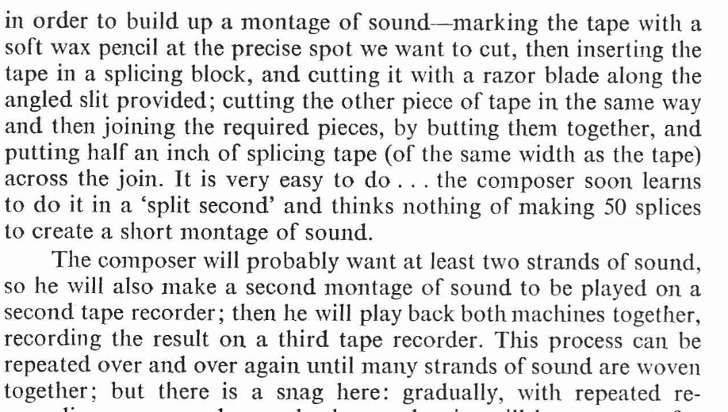

# The Third Tape Recorder - Exploration

Daphne Oram, An Individual Note of Music, p.62

To make our audio collages, we have been pasting into an ``existing audio file``, but there is

**NO REASON WE HAVE TO DO THIS**

We can first make a blank canvas (a third tape recorder), and then paste into this. 

```python
audio, sr = librosa.load("audio/drums.wav")
#Make 60 of silence
blank_audio = np.zeros(sr*60)
#Define insert point in samples
start = 3*sr
#How long is our audio to paste in?
end = start + len(audio)
#Paste into blank track
blank_audio[start:end] = audio
```

This week we'll be making audio collages.

For this exercise, your task is to create a unique sound collage by sourcing and manipulating a variety of audio clips. These can come from any sound material you find interesting—music, environmental recordings, spoken word, or other found sounds. You will use basic cut-and-paste operations to assemble these clips into a new composition, experimenting with the following techniques:

* Adjust the volume of individual clips to emphasise particular moments or create dynamic contrast within your piece.

* Cut and rearrange or repeat certain subsections of a longer sample.

* Use fades to control how sounds enter and exit, smoothing transitions or creating more abrupt changes.

* Experiment with reversing audio to see how this transforms the texture and meaning of the original sound.

* Change the speed of some clips, exploring how slowing down or speeding up affects their qualities and their role in the composition.

If you want to examine a sample to find good cut points, I'd recommend the free software [Audacity](https://www.audacityteam.org/download/)

As you work, consider whether your approach is more abstract focusing on creating unexpected juxtapositions and sound textures, or more musically sequenced, following a rhythmic or melodic pattern. Think about when you want to overwrite—replacing one sound with another, and when to mix sounds together.

Your final piece should reflect your creative decisions and the editing techniques you've applied.